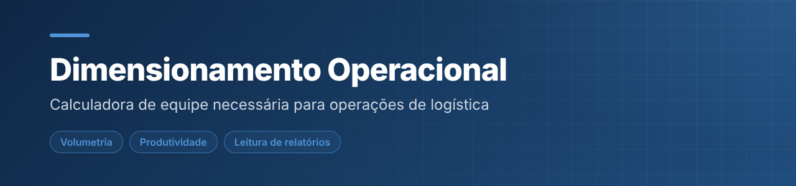
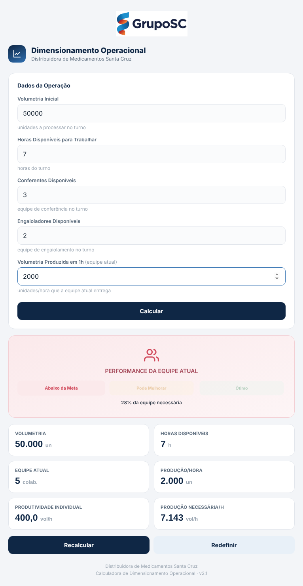

  

<h1 align="center">Calculadora de Dimensionamento Operacional</h1>

Ferramenta de logística que calcula a equipe necessária a partir de volumetria, horas disponíveis e produtividade, com medidores de desempenho e leitura automática de relatórios exportados do SAP. Funciona no computador e no celular.

  

     

---

## 📌 Sobre

Responde à pergunta do planejamento diário de uma operação: com este volume e este tempo, quantas pessoas eu preciso, e a equipe atual está abaixo ou acima da meta?

## 🖼️ Demonstração

  
   Cálculo da equipe necessária e medidor de performance

## ✨ Funcionalidades

- Cálculo da equipe necessária e medidor de performance (abaixo da meta, pode melhorar, ótimo)
- Painéis de **Conferência de Notas** e **Conferência de Engaiolamento**, com metas editáveis e cálculo individual por colaborador
- **Programador do dia seguinte**: calcula conferentes e engaioladores necessários e aplica no cenário do dia
- Leitura de relatórios em **Excel, Word e PDF** de uma pasta do computador, com visões Simplificada e Detalhada
- Filtro por colaborador, status por desempenho e tabelas expansíveis

## 🛠️ Tecnologias

`HTML5` · `CSS3` · `JavaScript` · `PDF.js` · `SheetJS` · `Mammoth.js` · `IndexedDB` · `File System Access API`

## ▶️ Como usar

Abra a demo, ou baixe o repositório e abra o `index.html` no navegador. Preencha o cenário do dia e clique em **Calcular**.

Não precisa instalar nada nem rodar servidor: é só HTML, CSS e JavaScript.

## 📝 Observações

A conexão com a pasta de relatórios usa a File System Access API e funciona em Chrome e Edge. As bibliotecas (PDF.js, SheetJS e Mammoth.js) são carregadas por CDN, então é preciso estar online.

---

## 👤 Autor

**Daniel da Silva Rezende** — estudante de Engenharia de Software e Análise e Desenvolvimento de Sistemas.

